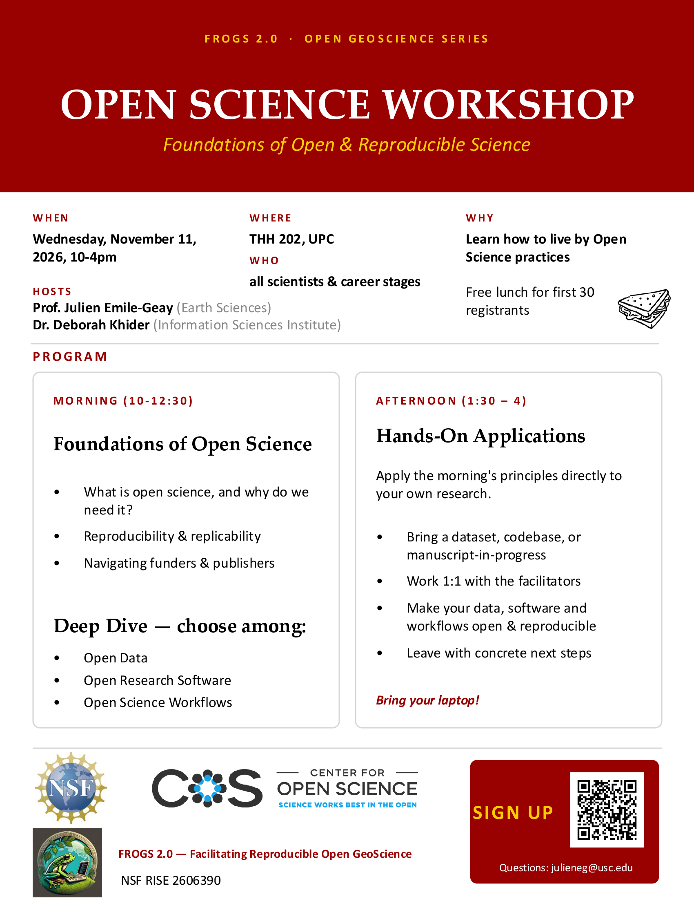

# Open Geoscience Workshop

This one day hackathon will introduce you to concepts in open science and the Pond Platform where you can learn more about how to publish you data, software and workflows. 

Our first stop is USC on November 11th, 2026! 

## University of Southern California - Nov 11th 2026. 

Register [here](https://forms.gle/5JWZwZsEzy3yrAn77)!

